# Path Planning and Obstacle Avoidance for a Tractor-Trailer Rover (MATLAB)

Standard planners like PRM, RRT and A\* treat the robot as a single point. That works for a rigid vehicle. With a trailer it fails: in every turn the trailer follows a **tighter arc than the tractor** (*off-tracking*). It cuts the corner and can hit an obstacle that the tractor avoided.

This repository contains my **Bachelor's thesis** (Automation Engineering, University of Bologna, 2025) and the **curricular internship at an agri-tech robotics startup** that led to it. Both develop a MATLAB framework that takes a "naive" path from a standard planner and makes it safe for the trailer:

1. **Plan** a path with PRM + Dijkstra and smooth it.
2. **Simulate** the tractor-trailer kinematics along the path.
3. **Detect** the dangerous segments with one of two methods:
   - **Method A**, collision-based: the trailer's swept-path envelope.
   - **Method B**, risk-based: a bounding circle combined with the hitch angle.
4. **Shift the segment back to its cause.** A *Maneuver Window* moves the start of the segment back to the steering maneuver that caused the problem.
5. **Replan** only that segment with a cubic **Bézier curve**. The curve is chosen by an iterative search scored on a `vehicleCostmap`.
6. **Validate** the new path with a second full simulation.

> 📄 Thesis: [`docs/Thesis_Magelli_2025.pdf`](docs/Thesis_Magelli_2025.pdf). *Path Planning and Obstacle Avoidance for an Autonomous Agricultural Rover with Trailer: Trajectory Modification with Bézier Curves and Path Following Control.* Supervisor Prof. Lorenzo Marconi, co-supervisor Ing. Nicolò Omodei.
> 📄 Internship report: [`docs/Internship_Report_Magelli.pdf`](docs/Internship_Report_Magelli.pdf). *Trajectory planning for autonomous vehicles with trailers, In-Row Navigation.*

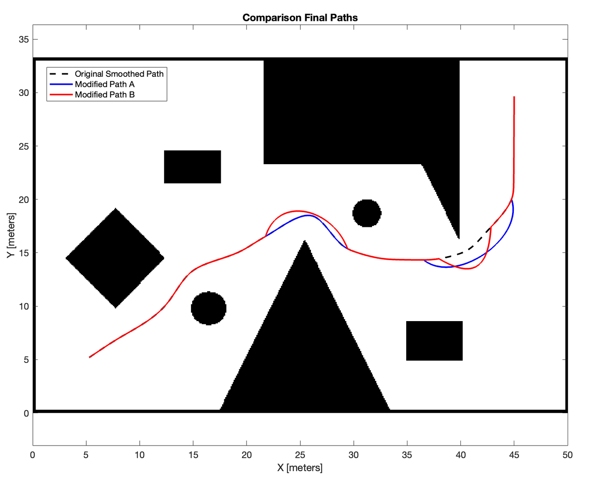

---

## Contents

| Folder | What it contains |
|---|---|
| [`thesis/method_A_envelope/`](thesis/method_A_envelope) | Full pipeline with **Method A**, collision-based detection on the trailer's swept-path envelope |
| [`thesis/method_B_bounding_circle/`](thesis/method_B_bounding_circle) | Full pipeline with **Method B**, risk-based detection: bounding circle + hitch angle |
| [`thesis/controller_comparison/`](thesis/controller_comparison) | Thesis chapter 4: **PID vs Pure Pursuit vs adaptive Pure Pursuit** and the effect of the lookahead distance |
| [`thesis/results/`](thesis/results) | Saved MATLAB workspaces of the runs reported in the thesis |
| [`internship_vineyard/`](internship_vineyard) | Internship project: **vineyard mission planner** with snap points, Bézier headland turns and PRM |
| [`evolution/`](evolution) | Seven snapshots that show how the code got from a first tractor-trailer simulation to the final framework |
| [`docs/`](docs) | Thesis, internship report and figures |

---

## The pipeline

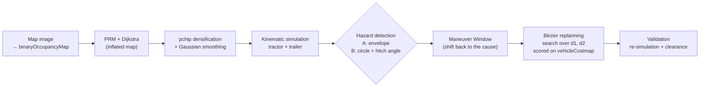

The framework works **offline**: it analyses and fixes the whole path before the vehicle starts moving. The original diagram from the thesis:

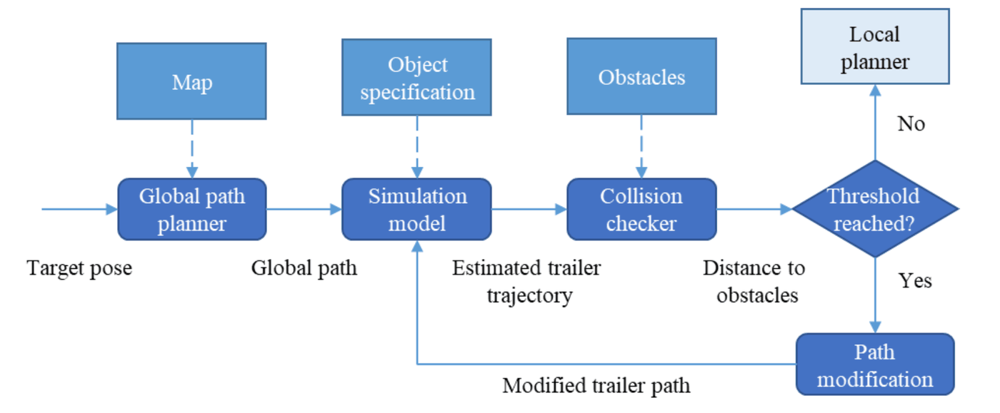

### Vehicle and environment

- **Kinematics.** The tractor follows the path with Pure Pursuit. The trailer is passive and is pulled through the hitch.
- **Geometry** (`geom()` in the scripts):

  | Parameter | Value |
  |---|---|
  | Tractor size | 2.50 × 1.40 m |
  | Trailer size | 1.50 × 1.45 m |
  | Hitch length | 2.00 m |
  | Speed | 0.5 m/s |
  | Time step | 0.05 s |
  | Lookahead | 1.0 m |

- **Map.** `Obstacles.png` becomes a 50 × 33.3 m `binaryOccupancyMap` at 10 cells/m. The planner uses a copy with obstacles inflated by 1 m.
- **Path.** PRM with 250 nodes and a 5 m connection radius, from (5, 5) to (45, 30). The PRM path is densified to 2200 points with `pchip` and smoothed with three Gaussian passes (windows 60, 45, 25).

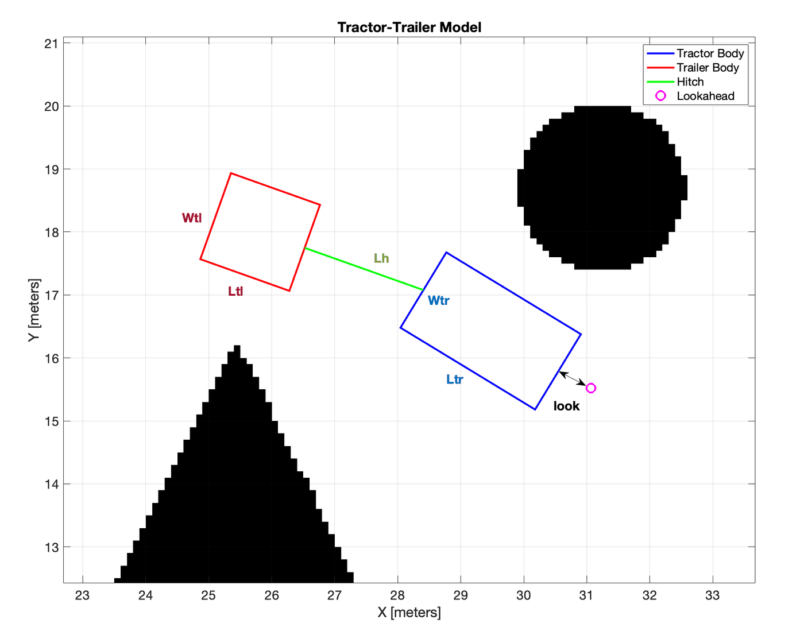

### Method A: collision-based detection (precise swept-path envelope)

At every simulation step:
- the trailer's footprint is merged into one `polyshape`, the **swept-path envelope**;
- each of its four corners is checked against the occupancy map.

A segment is flagged only when an **actual collision** occurs. The method is exact (no false positives) but reactive.

| Collision of the trailer | Segment to modify (after the Maneuver Window) |
|---|---|
| 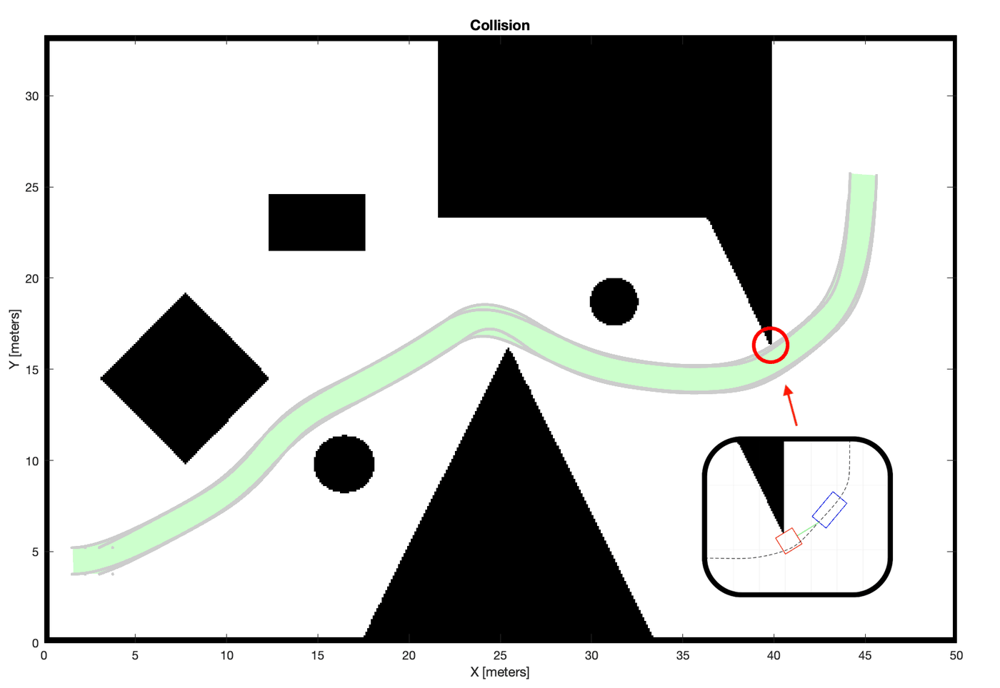 | 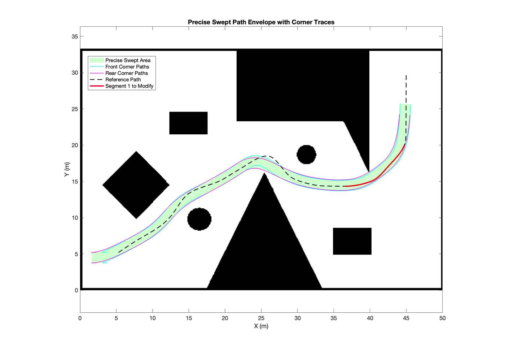 |

### Method B: risk-based detection (bounding circle + hitch angle)

A circle of radius (L<sub>tractor</sub> + L<sub>hitch</sub> + L<sub>trailer</sub>) / 2 = 3 m covers the whole vehicle. A moment is flagged as dangerous only when **two conditions hold together**:
- **proximity:** the circle hits an obstacle, checked with a distance transform of the map;
- **articulation:** the hitch angle is above 30°.

It is proactive: it also flags tight turns in narrow spaces that have not collided yet.

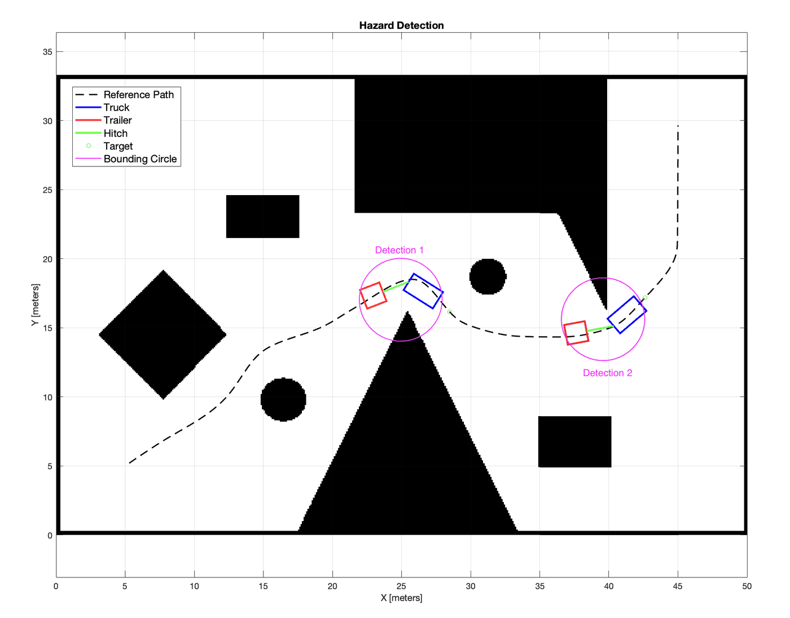

### Maneuver Window and Bézier replanning

A trailer collision is caused by a steering action of the tractor **several metres earlier**. The Maneuver Window converts a *causal distance* into a number of path samples and moves the start of the segment back by that amount. The end stays where it is.

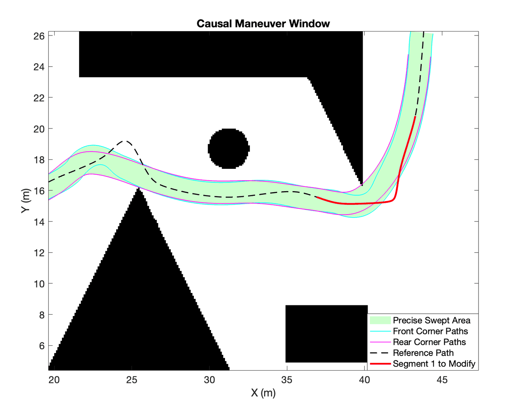

The segment is replaced by a cubic Bézier curve. It is built following the approach of Recker et al. (2021):
- **P0 and P3** are the endpoints of the segment;
- **P1 and P2** lie on the entry and exit tangents, at distances **d1** and **d2**.

`modify_curves_bezier.m` searches over d1 and d2. For each candidate curve it:
1. simulates the vehicle along the curve;
2. checks the tractor and trailer footprints on `vehicleCostmap` objects built with `inflationCollisionChecker`;
3. scores the curve with penalties for hard collisions, close calls (0.30 m), the curve crossing an obstacle, and self-intersections (loops).

The curve with the lowest score and **zero collisions** is chosen.

### Results

The same reference path (57.30 m) was corrected with both methods. The numbers below are taken from the saved workspaces in `thesis/results/`.

| Method | Modified path length | Length increase | Minimum trailer clearance |
|---|---|---|---|
| A: envelope (reactive) | 58.92 m | +2.84 % | ≈ 0.3 m |
| B: bounding circle (proactive) | 60.11 m | +4.91 % | ≈ 0.8 m |

Method A applies the smallest correction that removes the collision. Method B starts the turn earlier and makes a wider arc: the path is about 2 % longer and the clearance is more than twice as large.

| Clearance, Method A | Clearance, Method B |
|---|---|
| 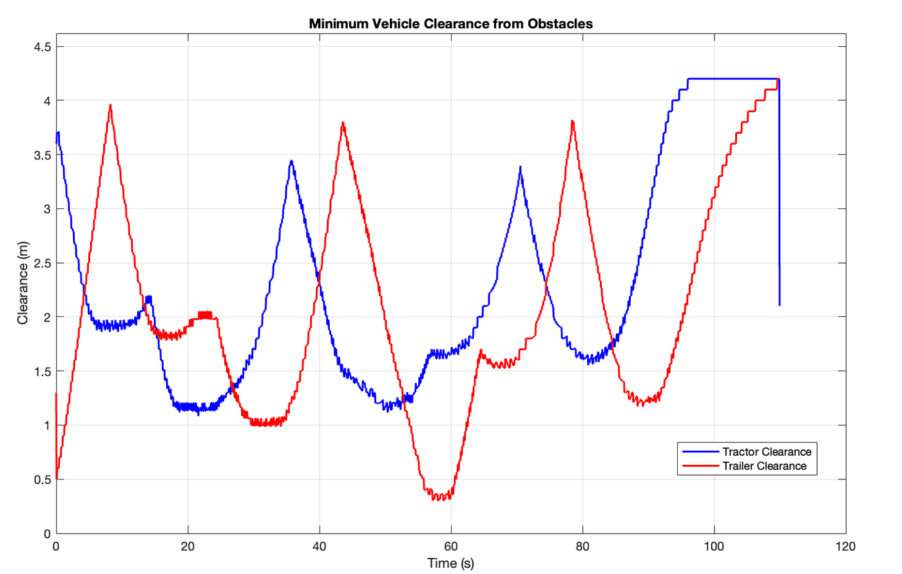 | 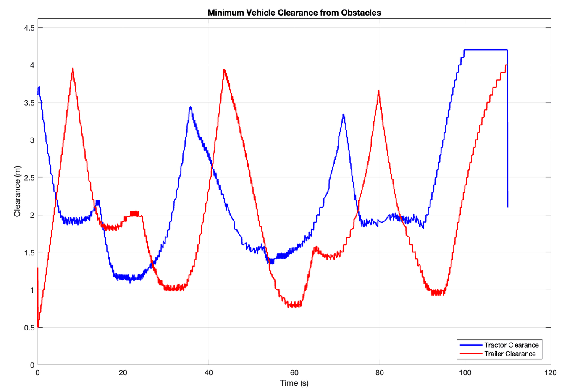 |

| Final path, Method A | Final path, Method B |
|---|---|
| 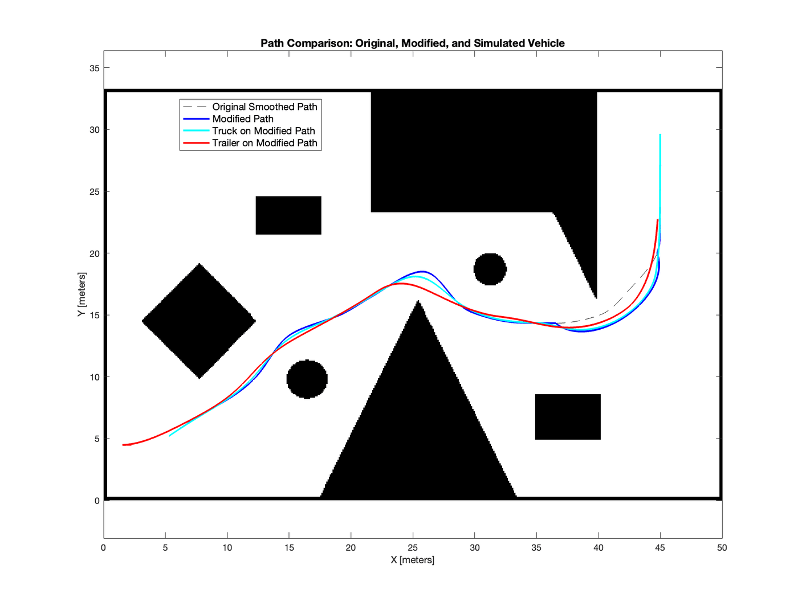 | 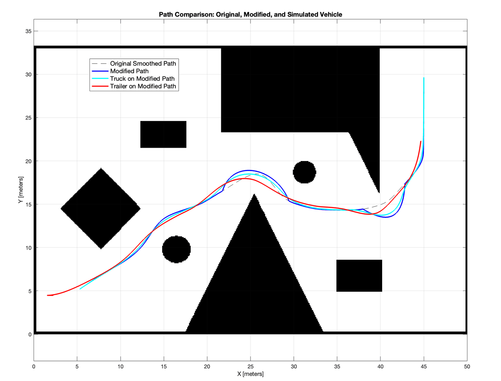 |

### Path-following controllers (thesis chapter 4)

[`compare_controllers.m`](thesis/controller_comparison/compare_controllers.m) compares three tractor controllers on five test paths: sine, rectangle, zigzag, spiral and step. The controllers are:
- **PID** on the heading error, with gains from `pidtune`;
- **Pure Pursuit with a fixed lookahead**;
- **curvature-adaptive Pure Pursuit**: the lookahead shrinks as the path curvature grows.

The metrics are the lateral (cross-track) error, given as RMS and maximum, and the control effort.

| Step response | Rectangle: lateral error and control effort |
|---|---|
| 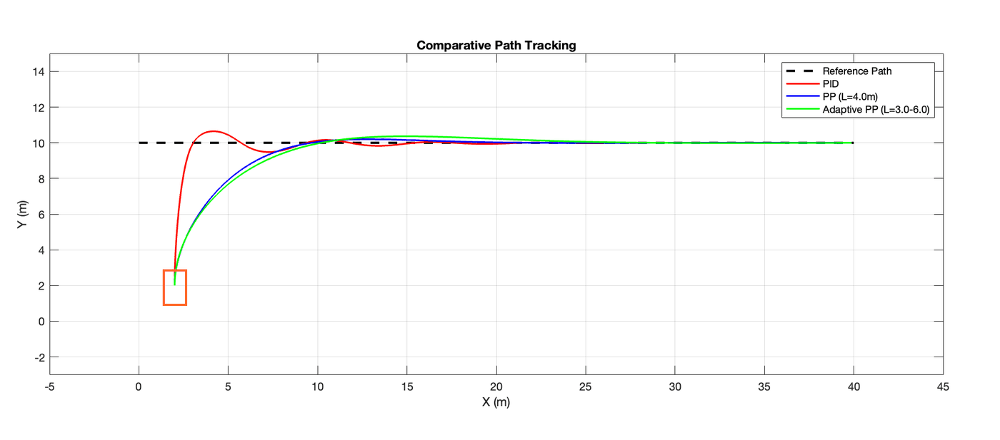 | 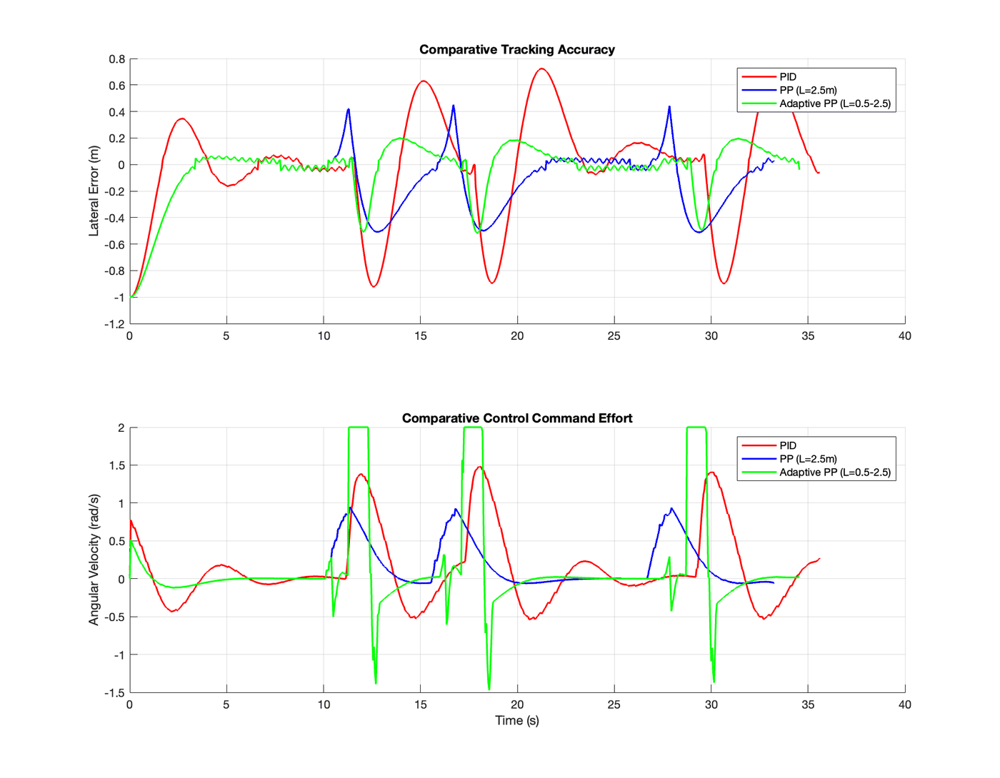 |

The effect of the lookahead distance (L = 0.1, 2.5 and 6 m): a short lookahead makes the robot oscillate, a long one makes it cut the corners.

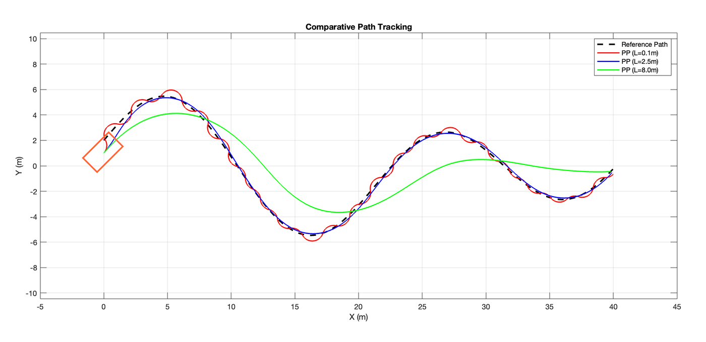

---

## Internship: vineyard mission planner

[`internship_vineyard/`](internship_vineyard) is the MATLAB application from the internship. A mission is written as high-level **snap-point** commands, such as `Row_1_BottomEntry` → `Row_1_TopExit` → `Row_2_TopEntry` … or custom poses. The planner:
- splits the mission into segments of three kinds:
  - **in-row** segments: straight lines;
  - **headland turns**: Bézier "U" turns wide enough for the trailer;
  - **open-field** segments to custom points: PRM + Dijkstra;
- simulates the tractor-trailer on each segment and corrects it with `modify_curves_bezier`.

| Mission map and waypoints | Bézier headland turn | Full planned path |
|---|---|---|
| 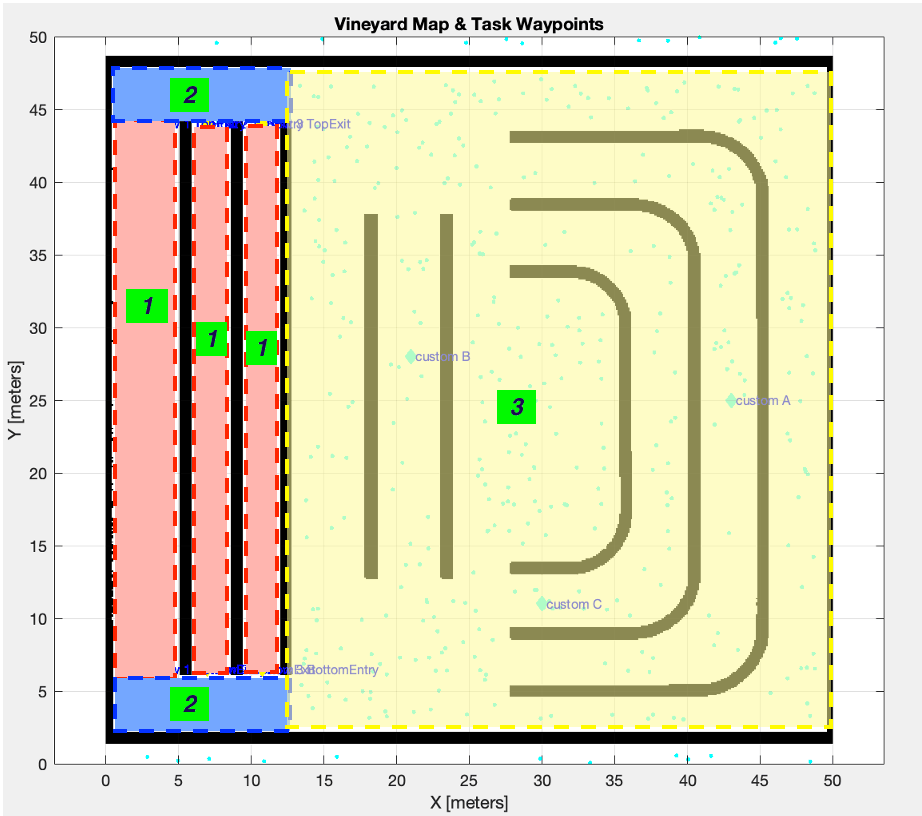 | 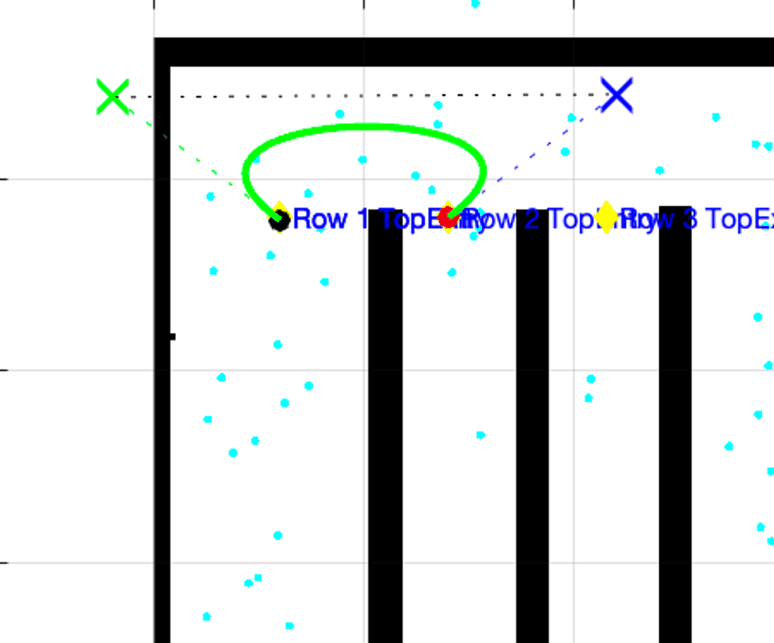 | 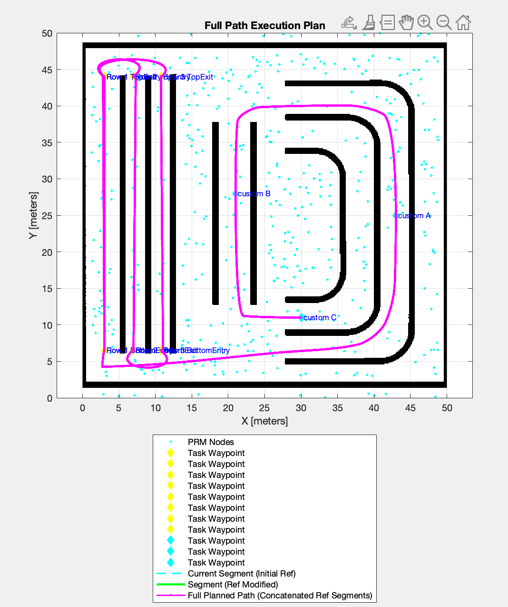 |

| File | Version |
|---|---|
| `vineyard_navigator.m` | Final version: snap points + custom points with PRM + Bézier modification per segment |
| `vineyard_navigator_v2_prm.m` | Second version: adds PRM for custom points |
| `vineyard_navigator_v1_snap_points.m` | First version: snap points and headland turns only |

The three versions share `modify_curves_bezier.m` and the map `filari.png`.

---

## How the code evolved

The [`evolution/`](evolution) folder keeps seven milestones from March to August 2025, in chronological order. Each folder is self-contained and has its own entry script. See [`evolution/README.md`](evolution/README.md) for details.

| # | Snapshot | Key step |
|---|---|---|
| 01 | First tractor-trailer | Pure Pursuit tractor + hitched trailer on a rectangular path |
| 02 | Modular simulator | `main → generate_path → simulate → animate → plot` |
| 03 | Open field + PRM | Map from an image, own PRM + Dijkstra, smoothing |
| 04 | First Bézier modification | Curves detected by angular velocity, Bézier replacement with fixed d1/d2 |
| 05 | Iterative Bézier search | Curvature-based detection, Recker-style d1/d2, iterative growth of d2 |
| 06 | Costmap-informed replanning | `vehicleCostmap` checks, global hotspots, close calls (+ PID/LQR experiments) |
| 07 | Controller comparison v1 | First tracking comparison with cross-track error metrics |

After these come the two final hazard-detection methods and the final controller study in `thesis/`.

---

## How to run

**Requirements**
- MATLAB (developed with **R2024a**).
- **Navigation Toolbox**: `binaryOccupancyMap`, `inflate`, `world2grid`.
- **Automated Driving Toolbox**: `vehicleCostmap`, `vehicleDimensions`, `inflationCollisionChecker`.
- **Image Processing Toolbox**: `bwdist`, `imbinarize`, `imresize`.
- **Control System Toolbox**: `pidtune`, only for the controller comparison.

**Run the thesis pipeline**
```matlab
cd thesis/method_A_envelope          % or thesis/method_B_bounding_circle
run_method_A_envelope                % or run_method_B_bounding_circle
```
Each folder is self-contained: the map, the simulator, the animation and the Bézier modifier are local copies. The two methods use different versions of `simulate_vehicle.m` and `animate_vehicles_with_map.m`, because Method B also computes and draws the bounding circle.

PRM is random, so every run produces a different reference path. To use **the exact path from the thesis**, set `USE_THESIS_PATH = true` near the end of Step 5 in the run script. The path is loaded from `thesis/results/method_A_workspace.mat`.

**Run the controller comparison** (interactive: the script asks which mode, path and controllers to use)
```matlab
cd thesis/controller_comparison
compare_controllers
```

**Run the vineyard planner**
```matlab
cd internship_vineyard
vineyard_navigator
```

## Notes

- **Causal distance.** The thesis text describes the causal distance of the Maneuver Window as hitch + trailer + tractor length. In the code that produced the reported results, the value differs by method:
  - Method A uses `Lh + Ltl + 2·Ltr` = 8.5 m, a shift of 326 samples;
  - Method B uses `Lh + Ltl` = 3.5 m, a shift of 134 samples.
- **Scope.** The model is purely kinematic, forward motion only, in a static and known map. Reverse motion, jackknife control, sensor noise and online replanning are left out. They are discussed as future work in thesis chapter 6.
- **Saved workspaces.** `thesis/results/*.mat` are the complete MATLAB workspaces of the two thesis runs: reference path, simulations, modified paths and hotspots. Load them to inspect the results without running the pipeline.

## Credits

- Thesis at the **University of Bologna** (DEI), supervised by **Prof. Lorenzo Marconi** and **Ing. Nicolò Omodei**.
- Curricular internship at an agri-tech robotics startup, with academic tutor **Prof. Riccardo Fini**.
- The Bézier path-modification idea follows *T. Recker, M. E. Matour, A. Raatz, "A simple and modular approach to path planning for tractor-trailer robots based on modification of pre-existing trajectories", 2021*.
- The kinematic model follows *E. Moreno, "Strategie di guida autonoma in retromarcia per robot mobili articolati", Politecnico di Torino, 2021*.
