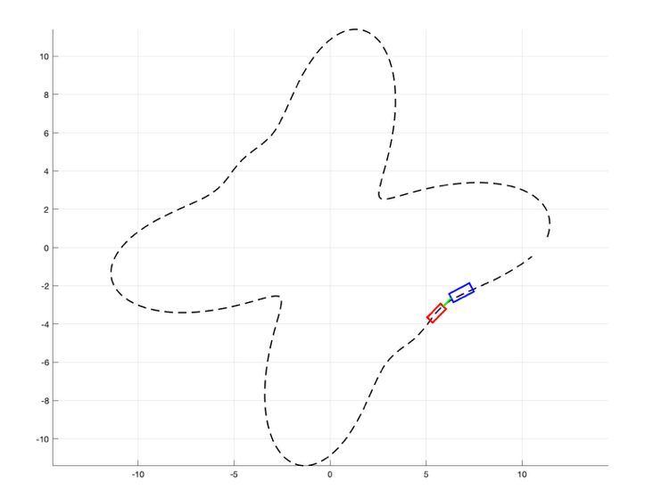
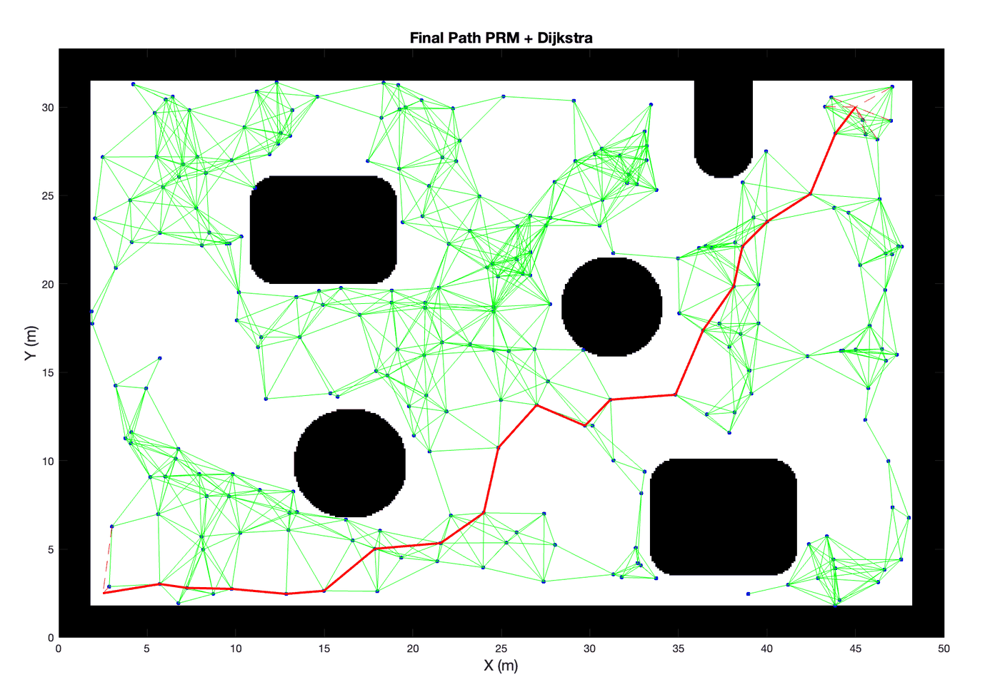
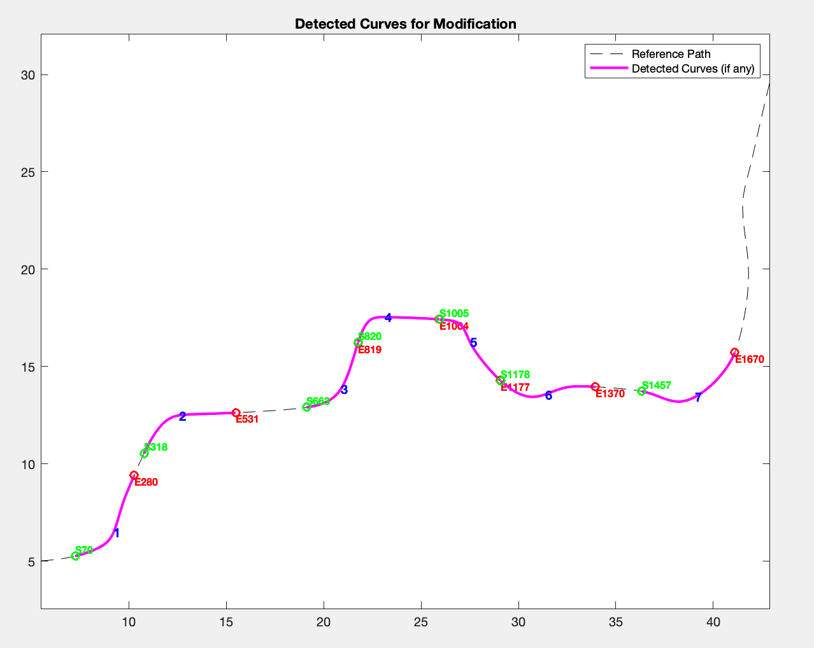

# Evolution of the code

Seven snapshots, in chronological order. Together they show how the project went from a first tractor-trailer simulation to the final framework in [`../thesis/`](../thesis).

These are **working snapshots, not polished code**. Each folder is self-contained: `cd` into it and run its entry script. Older snapshots use slightly different vehicle parameters and their own map.

| # | Folder | Period | Entry script | What changed |
|---|---|---|---|---|
| 01 | [`01_first_tractor_trailer`](01_first_tractor_trailer) | Mar 2025 | `simulation_purepursuit_fixed.m` | First kinematic model: Pure Pursuit tractor (steering limited to ±60°) and a trailer pulled through the hitch on a rectangular path |
| 02 | [`02_modular_simulator`](02_modular_simulator) | Mar 2025 | `main.m` | Code split into `generate_path → simulate_vehicle → animate_vehicles → plot_results`; tested on a smooth "flower" path |
| 03 | [`03_open_field_prm`](03_open_field_prm) | Apr 2025 | `openFieldMap.m` | Open-field map from an image (`binaryOccupancyMap` + inflation); own PRM + Dijkstra, `pchip` densification and Gaussian smoothing; vehicle simulated on the map |
| 04 | [`04_first_bezier_modification`](04_first_bezier_modification) | Apr 2025 | `openFieldMap.m` | First curve modification: curves detected from the angular velocity of the reference; Bézier replacement with fixed d1/d2. Two alternatives are kept as files but commented out in the main script: `plan_bezier_dual_d2` tries a tight and a wide curve and keeps the safer one (collisions, then hitch angle), and `plan_bezier_with_feedback` |
| 05 | [`05_iterative_bezier_search`](05_iterative_bezier_search) | Apr–May 2025 | `openFieldMap.m` | Curvature-based detection (κ > 0.3); Recker-style placement of d1/d2 from curvature and arc length; d2 grown iteratively until there are no hard collisions; original segment kept if every candidate is worse |
| 06 | [`06_costmap_informed_replanning`](06_costmap_informed_replanning) | Jun–Aug 2025 | `openFieldMap.m` | Safety checks with `vehicleCostmap` + `inflationCollisionChecker`; **global hotspots** (hard collisions and close calls) passed to the modifier; sustained-turn detection. `controller_experiments/` holds the first PID and LQR trajectory-tracking tests on a differential-drive robot |
| 07 | [`07_controller_comparison_v1`](07_controller_comparison_v1) | Aug 2025 | `main_comparison.m` | First controller comparison with the tractor-trailer model; cross-track error, curvature and sharp-turn detection helpers |

The final step, in [`../thesis/`](../thesis), replaced the curve-based detection with two dedicated hazard-detection methods: the swept-path envelope and the bounding circle with the hitch angle. It also added the **Maneuver Window**, the clearance analysis and a reworked, interactive controller comparison.

In the same period the internship's vineyard planner ([`../internship_vineyard/`](../internship_vineyard)) reused the Bézier modifier from step 06 for its headland turns and open-field segments.

| 02: modular simulator on the "flower" path | 03: own PRM + Dijkstra on the open-field map | Curve detection before the dedicated hazard-detection methods |
|---|---|---|
|  |  |  |
